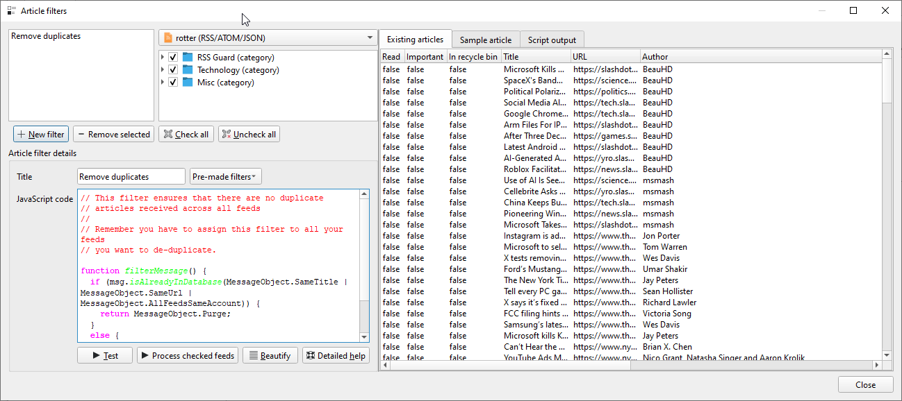

Article Filtering
=================
Article filters are JavaScript programs that can change incoming articles, assign labels, extract contents, or reject articles. They can also run on articles already stored in RSS Guard.

## Article filters dialog

Use the dialog to create, enable, order, and assign filters to feeds within an account.



* **Test** runs the selected filter against the loaded stored articles. It displays the result without saving the test articles.
* **Process checked feeds** runs the selected filter against undeleted articles in the checked feeds. Accepted results follow the same saving policy as regular fetching.

The **Existing articles** table shows the filtering decision and highlights changed values. Its tooltips compare original and filtered values; the detail tabs show metadata and contents. **Script output** displays `app.log(...)` messages and errors.

```{attention}
Testing does not save changes to the test articles, but it still executes the script. Network requests, external programs, notifications, and actions such as creating account labels can have effects. Inspect unfamiliar scripts before running them.
```

### Visual filter generator

Choose **Generate** next to **Beautify** to build a script from conditions, actions, and a result. Conditions can require all or any matches. The matching and non-matching branches have independent actions and results; no conditions means the matching branch applies to every article. The non-matching result defaults to **Accept**.

Actions can set writable article properties, manage labels, and choose a filtering decision. To request an explicit overwrite, add **Set article property** for `overwrite` and set it to `true` in the appropriate branch. It is opt-in; the generator does not enable it automatically.

```{warning}
Generating replaces the editor contents; it does not import or modify an existing script. Cancelling leaves the editor unchanged. The generator warns if neither reachable outcome accepts articles. Use handwritten JavaScript for database lookups, full-content extraction, notifications, and external tools.
```

## Writing and running filters

Each script defines a function that returns a [`FilteringAction`](#filteringaction-enum):

```js
function filterMessage() {
  return Msg.Accept;
}
```

During fetching, enabled filters run in ascending sort order on each incoming article. `Accept` continues to the next filter; other decisions stop that article's chain. The decision table below describes both fetching and manual processing.

The JavaScript engine is Qt's `QJSEngine`. The global `msg` object is the current article; the other [global objects](#global-variables) provide feed/account information and helpers. Special [user-data placeholders](userdata.md#data-placeholder), such as `%data%`, can be used in scripts.

```{warning}
Read changing values such as `msg.title` and `run.indexOfCurrentFilter` inside `filterMessage()`. Code outside that function is prepared once for the filtering run and should contain constants or helpers, not cached per-article state. An uncaught script error stops fetching that feed; the testing dialog displays the error directly.
```

### Saving accepted articles

A fetching filter starts with the incoming article, not a copy of the stored article. For local feeds, incoming read/star/trash flags normally start as `false`, and the score starts at zero. Manual processing and testing start with stored article values instead.

During both fetching and **Process checked feeds**, accepting an existing article does not force a database update. RSS Guard uses its existing identity, content, state, and date checks. Changing a script property alone does not introduce a new update trigger: for example, changing only local read state, score, or attachments can be skipped in either workflow. New accepted articles are inserted normally.

#### Explicit overwrite

```{attention}
New in 5.3.0: set **`msg.overwrite = true`** to force saving an accepted article even when ordinary update detection would skip it. This addresses filters whose changes were not saved when an article was fetched again ([#2490](https://github.com/martinrotter/rssguard/issues/2490)). Existing scripts retain ordinary fetching behavior until they opt in.
```

```js
function filterMessage() {
  msg.isRead = true;
  msg.overwrite = true;
  return Msg.Accept;
}
```

`overwrite` defaults to `false` at the start of each article-processing pass. Successive filters share its current value; a later filter can set it back to `false`. It is a temporary saving instruction, never stored in the database or synchronized to the service. Setting it on a detached article returned by a database lookup does not affect `msg`.

When `overwrite` is true, the writer saves the incoming read and starred states, including `false`, instead of applying local state preservation. It also bypasses body-change suppression and the ordinary date-based update gate. It does not override `Ignore`/`Purge`, change article matching, or bypass later feed-level ignoring and cleanup.

```{attention}
An overwrite saves the **complete set of fields supported by the existing article writer**, not just properties assigned by your script. Incoming read/star/trash states, score, contents, attachments, and dates can replace stored values. Use `getArticleFromDatabase()` and explicitly copy any stored values you need to preserve before enabling overwrite. Ordinary updates also use this writer; `overwrite = false` does not prohibit saving or enable field-by-field merging.
```

For example, a local feed with stable custom IDs can preserve selected stored state while explicitly marking an article read:

```js
function filterMessage() {
  const previous = msg.getArticleFromDatabase(Msg.SameCustomId);
  if (previous !== null) {
    msg.isImportant = previous.isImportant;
    msg.isDeleted = previous.isDeleted;
    msg.score = previous.score;
  }
  msg.isRead = true;
  msg.overwrite = true;
  return Msg.Accept;
}
```

This example preserves only the three copied properties. It still uses the incoming body, attachments, and dates. Temporary data such as `rawContents` does not gain database storage, and `overwrite` does not replace label associations wholesale: use the label methods for those changes.

#### Shared saving policy and settings

The existing preferences have clearer labels; saved preferences retain their meaning:

| Setting | Ordinary saving in either workflow | With `msg.overwrite = true` |
| :--- | :--- | :--- |
| **Ignore body-only changes from feeds** | Body differences alone do not trigger an update. An update triggered for another reason can still save the new body. | The explicit overwrite triggers saving regardless. |
| **Preserve read state on feed updates** | Keep the stored read state during local article updates, including manual filtering. When disabled, use the resulting article's read state. Synchronized accounts retain their existing state handling. | Save the filter's final read state. |

```{attention}
Changed in 5.3.0: **Process checked feeds no longer implicitly forces an update or bypasses local read-state preservation.** A manual filter that changes only read state, score, attachments, or similar fields must set `msg.overwrite = true` to guarantee saving. The same flag also allows clearing a stored local star. Returning `Accept` alone follows ordinary update detection in both workflows.
```

The workflows retain different inputs and purposes: fetching processes incoming data through the enabled assigned filter chain; manual processing applies the selected filter to stored undeleted articles. Manual duplicate checks exclude the current article, and manual `Purge` physically removes it. Manual processing does not generate normal new-article fetch notifications. These differences do not change the shared saving policy. The overwrite flag controls local persistence; it does not add new remote synchronization operations.

Label assignments are processed separately and can be saved without an article-row update. They do not require `overwrite`.

#### Deleted articles and side effects

```{attention}
A matching **permanently deleted** database record is protected during article updates, including its label associations. Neither `overwrite` nor a forced update can alter or restore it, for local or synchronized accounts. Ordinary recycle-bin articles are different: the existing writer can restore them when an eligible update saves `isDeleted = false`.
```

Emptying the recycle bin marks records permanently deleted while retaining them for matching. Physically purging records removes that protection, so a later fetch can insert an article again. Matching still relies on the existing identifiers; this protection cannot recognize a different identity as the same article.

Filters run before this persistence check, so their other effects are not undone when a permanently deleted match is skipped. Feed-level ignore rules and article-count cleanup also run after filtering and may prevent an accepted article from being retained. Normal fetch notifications exclude saved articles in trash and permanently deleted records; script calls to `app.showNotification()` are independent.

```{attention}
Supported changes can be pushed to an online service even if a filter returns `Ignore` or `Purge`. Current automatic handling pushes transitions to read/starred and processes label changes separately; `overwrite` does not introduce reverse transitions or broader remote synchronization. Local saving decisions do not undo service requests or other script side effects.
```

### Database lookups

Exact `isAlreadyInDatabase()` and `getArticleFromDatabase()` include recycled and permanently deleted records. Their Winkler variants search only undeleted records. Choose exact matching when you need to recover stored state for the same article custom ID; similarity matching is intended for finding similar articles.

Lookup criteria are combined with bitwise OR. Without `AllFeedsSameAccount`, the search is limited to the current feed; with it, the search includes the current account's feeds. During manual processing/testing, the current stored article is excluded from duplicate matching. The current `msg` already contains its stored values in that mode.

Returned articles are detached copies. Modifying them does not save them or modify the incoming article; copy the desired properties to `msg`. The API exposes recycle-bin state as `isDeleted`, but does not expose the internal permanent-deletion flag.

### Practical guidance

Run cheap rejection/duplicate checks before expensive extraction or external commands. Use `app.log(...)` and the testing table to inspect results. Downloads can slow fetching and enlarge the database; external tools may also depend on your operating system.

## Global variables

These global objects are available to your scripts:

| Global variable | What it provides |
| :---            | :--- |
| `msg`           | Information about the actual article being filtered or modified. |
| `feed`          | Information about the feed the article belongs to. |
| `acc`           | Account-related information. |
| `app`           | Application-wide helper functions such as logging and notifications. |
| `utils`         | Utility functions for parsing data and reading or writing files. |
| `run`           | Information about the current filtering run. |
| `fs`            | Process-launching helpers for calling external executables. |

## Reference Documentation

Here is the complete reference documentation of the functions and properties available to your filtering scripts.

### `msg`

#### Properties

| Name               | Type                      | Read-only | Synchronized | Description |
| :---               | :---                      | :---:     | :---:        | :--- |
| `assignedLabels`   | `Array<Label>`            | Yes       | Yes          | List of labels assigned to the article. |
| `categories`       | `Array<MessageCategory>`  | Yes       | No           | List of categories of the article, extracted from the feed. |
| `enclosures`       | `Array<MessageEnclosure>` | Yes       | No           | List of attachments of the article. |
| `id`               | `Number`                  | Yes       | No           | ID assigned to the message in the local RSS Guard database. |
| `customData`       | `String`                  | Yes       | No           | Opaque custom data associated with the article. Its format depends on the article source; structured data may commonly be encoded as JSON. |
| `customId`         | `String`                  | No        | No           | ID of the message as provided by the remote service or feed file. |
| `title`            | `String`                  | No        | No           | The message title. |
| `url`              | `String`                  | No        | No           | The message URL. |
| `author`           | `String`                  | No        | No           | Author of the message. |
| `contents`         | `String`                  | No        | No           | Contents of the message. |
| `rawContents`      | `String`                  | No        | No           | Raw contents obtained from the remote service or feed. This is usually raw XML or JSON. It is normally useful only for newly fetched articles, not when testing existing ones from the dialog. |
| `score`            | `Number`                  | No        | No           | Arbitrary number in the range \<0.0, 100.0\>. Useful for custom ranking and sorting. |
| `hasEnclosures`    | `Boolean`                 | Yes       | No           | Returns `true` if the article has at least one attachment (enclosure). |
| `created`          | `Date`                    | No        | No           | Date and time of the message. |
| `retrieved`        | `Date`                    | No        | No           | Date and time when RSS Guard received this version of the message. |
| `createdIsMadeup`  | `Boolean`                 | No        | No           | Is `true` if the message timestamp was synthesized instead of taken from the source feed. |
| `isRead`           | `Boolean`                 | No        | Yes          | Is the message read? |
| `isImportant`      | `Boolean`                 | No        | Yes          | Is the message important? |
| `isDeleted`        | `Boolean`                 | No        | No           | Recycle-bin state. This is not the permanent-deletion flag. |
| `overwrite`        | `Boolean`                 | No        | No           | Defaults to `false` per article pass. Set to `true` to force saving the accepted full article result and its read/star states; cannot override permanent deletion. See [Explicit overwrite](#explicit-overwrite). |

#### Functions

| Name(Parameters)                                                              | Return value | Description |
| :---                                                                          | :---         | :--- |
| `addEnclosure(String url, String mime_type)`                                  | `void`       | Adds a multimedia attachment to the article. |
| `removeEnclosure(int index)`                                                  | `Boolean`    | Removes one attachment from the article according to the index, starting from zero. |
| `removeAllEnclosures()`                                                       | `void`       | Removes all attachments from the article. |
| `fetchFullContents(Boolean plain_text_only)`                                  | `Boolean`    | Fetches full contents through the [article extractor](extractor), in plain text or HTML. Returns whether nonempty contents were obtained. Does not enable overwrite. |
| `isAlreadyInDatabase(DuplicityCheck criteria)`                                | `Boolean`    | Checks if a matching message is already stored in the database. |
| `isAlreadyInDatabaseWinkler(DuplicityCheck criteria, Number threshold = 0.1)` | `Boolean`    | Checks if a similar message is already stored in the database by using Jaro-Winkler similarity. |
| `getArticleFromDatabase(DuplicityCheck criteria)`                             | `FilterMessage` or `null` | Returns a detached copy of the matching article with the highest local ID. See [Database lookups](#database-lookups) for scope and deletion handling. |
| `getArticleFromDatabaseWinkler(DuplicityCheck criteria, Number threshold = 0.1)` | `FilterMessage` or `null` | Returns a detached copy of the undeleted matching article with the highest local ID, using Jaro-Winkler similarity. |
| `assignLabel(String label_id)`                                                | `Boolean`    | Assigns a label to the message. The `String` value is the `customId` property of the `Label` type. |
| `deassignLabel(String label_id)`                                              | `Boolean`    | Removes a label from the message. The `String` value is the `customId` property of the `Label` type. |
| `deassignAllLabels()`                                                         | `void`       | Removes all labels from the message. |
| `exportCategoriesToLabels(Boolean assign_to_message)`                         | `void`       | Creates labels for incoming article categories and optionally assigns them. Does nothing in existing-article processing mode. |

### `app`

#### Functions

| Name(Parameters)                              | Return value | Description |
| :---                                          | :---         | :--- |
| `log(String message)`                         | `void`       | Prints a message to RSS Guard's log and to the `Script output` box in the dialog. |
| `showNotification(String title, String text)` | `void`       | Displays a desktop notification with the given title and text. |

### `run`

#### Properties

| Name                       | Type     | Read-only | Description |
| :---                       | :---     | :---:     | :--- |
| `numberOfAcceptedMessages` | `Number` | Yes       | Number of messages accepted so far in the current filtering run. |
| `indexOfCurrentFilter`     | `Number` | Yes       | Zero-based index of the currently executing filter. |
| `totalCountOfFilters`      | `Number` | Yes       | Total number of filters that will execute in the current run. |

### `acc`

#### Properties

| Name              | Type           | Read-only | Description |
| :---              | :---           | :---:     | :--- |
| `id`              | `Number`       | Yes       | Database ID of the account. |
| `title`           | `String`       | Yes       | Title of the account. |
| `availableLabels` | `Array<Label>` | Yes       | List of labels currently available for assignment. |

#### Functions

| Name(Parameters)                                         | Return value | Description |
| :---                                                     | :---         | :--- |
| `findLabel(String label_title)`                          | `String`     | Finds a label with the given title. Returns the label ID or an empty string. |
| `createLabel(String label_title, String hex_color_code)` | `String`     | Creates a label with the given title and color and returns the label ID. If the label already exists, its existing ID is returned. |

### `feed`

#### Properties

| Name       | Type     | Read-only | Description |
| :---       | :---     | :---:     | :--- |
| `customId` | `String` | Yes       | Custom ID of the feed. |
| `title`    | `String` | Yes       | Title of the feed. |

### `utils`

#### Properties

| Name       | Type     | Read-only | Description |
| :---       | :---     | :---:     | :--- |
| `hostname` | `String` | Yes       | Name of your local machine. |

#### Functions

| Name(Parameter)                                | Return value  | Description |
| :---                                           | :---          | :--- |
| `fromXmlToJson(String xml_string)`             | `String`      | Converts an XML string into JSON. |
| `readFile(String filename)`                    | `ArrayBuffer` | Reads a file into a byte array. |
| `writeFile(String filename, ArrayBuffer data)` | `void`        | Writes a byte array to a file. |
| `readTextFile(String filename)`                | `String`      | Reads a text file as UTF-8. |
| `writeTextFile(String filename, String text)`  | `void`        | Writes text as UTF-8. |
| `parseDateTime(String date_time)`              | `Date`        | Converts a textual date/time representation into a proper `Date` object. |

### `fs`

#### Functions

| Name(Parameter)                                                                | Return value  | Description |
| :---                                                                           | :---          | :--- |
| `runExecutable(String exec, Array<String> params, String stdin_data, String working_directory)`          | `void`        | Launches an external executable with optional parameters, standard input, and working directory, without waiting for it to finish. |
| `runExecutableGetOutput(String exec, Array<String> params, String stdin_data, String working_directory)` | `String`      | Launches an external executable, waits for it to finish, and returns its standard output as text. |

```{warning}
External processes launched through `fs` use the RSS Guard user-data folder as the default working directory unless you explicitly pass another one.
```

### Shared Data Types

#### `FilteringAction` enum

| Enumerant name | Integer value | Description |
| :---           | :---          | :--- |
| `Accept`       | 1             | Keep the article and continue its filter chain. Persistence follows [Saving accepted articles](#saving-accepted-articles). |
| `Ignore`       | 2             | Stop the chain and skip saving this article. An existing stored article is retained unchanged. |
| `Purge`        | 4             | During fetching, behaves like `Ignore`, including for a fetched article that already exists locally. During manual processing, physically removes the current stored article. |
#### `DuplicityCheck` enum

| Enumerant name        | Integer value | Description |
| :---                  | :---          | :--- |
| `SameTitle`           | 1             | Check if the message has the same title as another message. |
| `SameUrl`             | 2             | Check if the message has the same URL as another message. |
| `SameAuthor`          | 4             | Check if the message has the same author as another message. |
| `SameDateCreated`     | 8             | Check if the message has the same creation date as another message. |
| `AllFeedsSameAccount` | 16            | Perform the check across all feeds in the account, not just the current feed. |
| `SameCustomId`        | 32            | Check if a message with the same custom ID exists in the RSS Guard DB. |

#### `MessageEnclosure`

Represents an article attachment (called an enclosure in feed formats and the filtering API).

##### Properties

| Name       | Type     | Read-only | Description |
| :---       | :---     | :---:     | :--- |
| `url`      | `String` | No        | URL of the article attachment. |
| `mimeType` | `String` | No        | MIME type of the article attachment. |

#### `MessageCategory`

##### Properties

| Name    | Type     | Read-only | Description |
| :---    | :---     | :---:     | :--- |
| `title` | `String` | Yes       | Title of the message category. |

#### `Label`

##### Properties

| Name       | Type     | Read-only | Description |
| :---       | :---     | :---:     | :--- |
| `title`    | `String` | Yes       | Label name. |
| `customId` | `String` | Yes       | Service-specific ID of the label. Useful when assigning or removing labels from messages. |


## Examples

Examples use the saving rules above. Examples that enable `overwrite` intentionally opt into full-row replacement; adapt their state preservation to your needs.

```js
/*
 * Accept whitelisted articles based on regular-expression filtering.
 */
function filterMessage() {
  const whitelist = [
    /ubuntu.+desktop/i,
    /linux.+app/i,
    /\d.billion/i
  ];

  if (whitelist.some(re => re.test(msg.title))) {
    return Msg.Accept;
  }

  return Msg.Ignore;
}
```

```js
/*
 * Mark matching articles as important and raise their score on every fetch.
 */
function filterMessage() {
  if (/stock|crypto|market/i.test(msg.title)) {
    msg.isImportant = true;
    msg.score = 80;
    msg.overwrite = true;
  }

  return Msg.Accept;
}
```

```js
/*
 * Skip likely duplicates by comparing title similarity.
 */
function filterMessage() {
  if (msg.isAlreadyInDatabaseWinkler(Msg.SameTitle, 0.05)) {
    return Msg.Ignore;
  }

  return Msg.Accept;
}
```

```js
/*
 * Reuse contents from the newest stored article with the same URL.
 */
function filterMessage() {
  const previous = msg.getArticleFromDatabase(
    Msg.SameUrl | Msg.AllFeedsSameAccount
  );

  if (previous !== null) {
    msg.contents = previous.contents;
  }

  return Msg.Accept;
}
```

```js
/*
 * Fetch fuller contents only for articles that seem new enough to keep.
 *
 * This uses RSS Guard's built-in article extractor automatically.
 */
function filterMessage() {
  if (!msg.isAlreadyInDatabase(Msg.SameCustomId | Msg.AllFeedsSameAccount)) {
    msg.fetchFullContents(false);
  }

  return Msg.Accept;
}
```

```js
/*
 * Run RSS Guard's article extractor directly on HTML already stored in msg.contents.
 *
 * This is useful when the feed already carries HTML and you want readability cleanup
 * without downloading the article URL again.
 */
function filterMessage() {
  if (!msg.url || !msg.contents) {
    return Msg.Accept;
  }

  const extractor =
    "C:\\Path\\To\\rssguard-article-extractor.exe";

  const config = JSON.stringify({
    html: msg.contents
  });

  const extracted = fs.runExecutableGetOutput(
    extractor,
    [msg.url],
    config
  );

  if (extracted && extracted.trim()) {
    msg.contents = extracted.trim();
  }

  return Msg.Accept;
}
```

```js
/*
 * Ignore articles older than 7 days.
 */
function filterMessage() {
  let now = new Date();
  let age = (now - msg.created) / (1000 * 60 * 60 * 24);

  if (age > 7) {
    return Msg.Ignore;
  }

  return Msg.Accept;
}
```

```js
/*
 * During manual processing, purge articles received more than 2 days ago.
 * This differs from msg.created, which is the publication date from the feed.
 */
function filterMessage() {
  let now = new Date();
  let age = (now - msg.retrieved) / (1000 * 60 * 60 * 24);

  if (age > 2) {
    return Msg.Purge;
  }

  return Msg.Accept;
}
```

```js
/*
 * Assign label "AI" to matching articles.
 * Make sure the label already exists.
 */
function filterMessage() {
  if (/AI|robot|software|hardware/i.test(msg.title)) {
    let id = acc.findLabel("AI");

    if (id) {
      msg.assignLabel(id);
    }
  }

  return Msg.Accept;
}
```

```js
/*
 * Create labels automatically from message categories.
 */
function filterMessage() {
  msg.exportCategoriesToLabels(true);
  return Msg.Accept;
}
```

```js
/*
 * Show a desktop notification only for apparently new breaking news.
 */
function filterMessage() {
  if (/breaking/i.test(msg.title) &&
      !msg.isAlreadyInDatabaseWinkler(Msg.SameTitle, 0.05)) {
    app.showNotification("Breaking News", msg.title);
    msg.isImportant = true;
  }

  return Msg.Accept;
}
```

```js
/*
 * Turn the first attachment into the main article URL.
 */
function filterMessage() {
  if (msg.enclosures.length > 0) {
    msg.url = msg.enclosures[0].url;
    msg.removeEnclosure(0);
  }

  return Msg.Accept;
}
```

```js
/*
 * Use a keyword file from the user-data folder to assign a score.
 *
 * Each line should be:
 *   keyword,score
 */
function filterMessage() {
  let keywords = [];

  try {
    let fileContent = utils.readTextFile('%data%/keywords.txt');
    keywords = fileContent
      .split(/\r?\n/)
      .map(line => {
        let parts = line.split(',');
        if (parts.length === 2) {
          return { term: parts[0].trim(), score: Number(parts[1].trim()) };
        }
        return null;
      })
      .filter(k => k && !isNaN(k.score));
  } catch (e) {
    app.log('Keywords file missing -> default score 0.');
    msg.score = 0;
    msg.overwrite = true;
    return Msg.Accept;
  }

  let totalScore = 0;

  for (let k of keywords) {
    let re = new RegExp(k.term, 'i');
    if (re.test(msg.title) || re.test(msg.contents)) {
      totalScore += k.score;
    }
  }

  msg.score = Math.min(totalScore, 100);
  msg.overwrite = true;

  if (msg.score >= 70) {
    msg.isImportant = true;
  }

  return Msg.Accept;
}
```

```js
/*
 * Keep a whitelist in an external text file.
 */
function filterMessage() {
  let keywords = [];

  try {
    let fileContent = utils.readTextFile('%data%\\whitelist.txt');
    keywords = fileContent.split(/\r?\n/).filter(line => line.trim() !== '');
  } catch (e) {
    app.log('No whitelist file found, accepting all articles.');
    return Msg.Accept;
  }

  for (let k of keywords) {
    let re = new RegExp(k, 'i');
    if (re.test(msg.title) || re.test(msg.contents)) {
      msg.isImportant = true;
      return Msg.Accept;
    }
  }

  return Msg.Ignore;
}
```

```js
/*
 * Convert HTML article contents to plain text.
 */
function filterMessage() {
  let text = msg.contents;

  text = text.replace(
      /<a[^>]+href="([^"]+)"[^>]*>(.*?)<\/a>/gi, (m, url, label) => {
        return label + ' (' + url + ')';
      });

  text = text.replace(/<[^>]*>/g, '');
  text = text.replace(/\s+/g, ' ').trim();

  msg.contents = text;

  return Msg.Accept;
}
```

```js
/*
 * Convert article contents from HTML to plain text with Pandoc.
 *
 * This uses a Pandoc binary placed directly in the user-data folder.
 */
function filterMessage() {
  let res = fs.runExecutableGetOutput(
      '%data%\\pandoc.exe',
      ['-f', 'html', '-t', 'plain'],
      msg.contents);

  msg.contents = res;

  return Msg.Accept;
}
```

```js
/*
 * Parse raw XML and log one field while debugging.
 */
function filterMessage() {
  if (msg.rawContents) {
    let rawJson = utils.fromXmlToJson(msg.rawContents);
    app.log(rawJson);
  }

  return Msg.Accept;
}
```

```js
/*
 * Raise the score for articles published on weekends.
 */
function filterMessage() {
  let day = msg.created.getDay(); // 0 = Sunday, 6 = Saturday

  if (day === 0 || day === 6) {
    msg.score = Math.min(msg.score + 15, 100);
    msg.overwrite = true;
  }

  return Msg.Accept;
}
```
